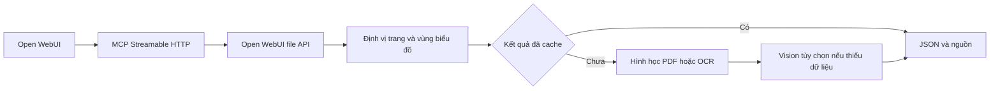

# Chart Extraction MCP

MCP server độc lập cho Open WebUI. Server tìm và đọc biểu đồ cột hoặc biểu đồ tròn trong PDF khi được gọi, rồi trả số liệu, ngữ cảnh và nguồn theo trang. Open WebUI tiếp tục dùng Knowledge RAG cho phần văn bản.

## Chạy với Docker

Yêu cầu Docker Compose và một container Open WebUI đang chạy. Cấu hình mẫu dùng container tên `open-webui` và giao diện tại `http://127.0.0.1:3001`.

```bash
cp .env.example .env
docker network inspect chart-mcp-local >/dev/null 2>&1 || docker network create chart-mcp-local
docker network connect chart-mcp-local open-webui
docker compose up -d --build
curl -fsS http://127.0.0.1:8765/health
```

Bỏ qua lệnh `docker network connect` nếu Open WebUI đã tham gia mạng. Nếu tên container, cổng hoặc mạng khác, sửa các biến tương ứng trong `.env`. Khi tạo lại container Open WebUI, hãy nối lại mạng hoặc khai báo mạng trong Compose của nó. Docker image có Tesseract với dữ liệu tiếng Anh và tiếng Việt. Đặt `OCR_LANGUAGE=vie+eng` nếu cần cả hai.

## Kết nối Open WebUI

Trong **Admin Settings → Integrations → External Tool Servers**, thêm một kết nối với **MCP (Streamable HTTP)**, URL `http://chart-mcp:8765/mcp` và auth **Session**. Lưu rồi bật **Chart Extraction** trong chat có model hỗ trợ Native function calling. Giới hạn quyền dùng kết nối qua Access Control nếu có nhiều người dùng. [Tài liệu MCP của Open WebUI](https://docs.openwebui.com/features/extensibility/mcp/)

Mỗi tool yêu cầu UUID đính kèm thật của Open WebUI. Nếu model chưa có ID từ metadata đính kèm, lấy `id` từ response upload `POST /api/v1/files/` trong Network hoặc giao cho model qua prompt. Tool không dò tài liệu theo tên. Chỉ có tên, tiêu đề hoặc một đoạn Knowledge RAG thì chưa đủ để suy ra quyền hoặc định danh. Tài liệu nhiều trang dùng discovery để lấy `chart_id` và trang trước khi trích xuất.

Ví dụ prompt sau khi bật tool

> Hãy gọi extract_chart với file_id `<UUID từ Open WebUI>`, page_number 1 và câu hỏi “Doanh thu Q2 là bao nhiêu?”. Dẫn source.url và source.page. Nếu dữ liệu ước lượng, nói rõ.

## Tools

| Tool | Input | Output |
| --- | --- | --- |
| `list_document_charts` | `file_id`, `start_page` tùy chọn | Biểu đồ và ứng viên theo trang, caption, bbox, `next_page` |
| `extract_chart` | `file_id`, `question`, `page_number` hoặc `chart_id` | Tiêu đề, trục, đơn vị, dữ liệu, ngữ cảnh, nguồn và trạng thái cache |
| `get_chart_source` | `file_id`, `chart_id` | URL PDF gốc, trang, bbox và ngữ cảnh |

Trang bắt đầu từ 1. Bbox là tọa độ PDF theo điểm, thứ tự `[x0, y0, x1, y1]`, với gốc ở góc trên bên trái của trang đã chuẩn hóa xoay. URL dùng phiên Open WebUI của người xem.

```json
{
  "file_id": "<UUID của file PDF>",
  "page_number": 1,
  "question": "Doanh thu Q2 là bao nhiêu?"
}
```

Nếu có nhiều biểu đồ trên cùng trang, gọi discovery rồi truyền `chart_id`. Trường `question` mang mục đích trả lời. Kết quả trích xuất bao gồm toàn bộ dữ liệu đọc được của biểu đồ đã chọn, giúp nhiều câu hỏi dùng lại cache.

## Cách xử lý



- Server xác nhận bearer session với Open WebUI và tải PDF qua endpoint nội dung của **chính phiên đó**. Cache chỉ được tra sau khi Open WebUI cho phép đọc file. API không nhận đường dẫn hệ thống hoặc URL do model cung cấp.
- PyMuPDF nhận diện nhóm cột đứng và vùng hình. Dữ liệu vector ưu tiên số in trên biểu đồ. Nếu đủ mốc trục tuyến tính bắt đầu từ 0, số đọc theo chiều cao được đánh dấu `axis_estimate`.
- Với biểu đồ ảnh phẳng, server tìm nhóm cột đồng màu và dùng Tesseract đọc nhãn. Ảnh có caption nhưng chưa phân loại được xuất hiện dưới dạng `candidate`.
- Server liên kết heading, caption và vài dòng văn bản trước/sau dựa trên vị trí. Giá trị không xác định trả `null`. Trạng thái `partial`, `unreadable` và `unsupported` cho biết khi thiếu dữ liệu.
- SQLite lưu kết quả trích xuất theo hash PDF, trang/vùng, phiên bản extractor và cấu hình OCR/Vision. Cache hit bỏ qua OCR/Vision. File vẫn được xác quyền, tải và định vị lại. Mặc định cache hết hạn sau 168 giờ.
- Biểu đồ tròn vector đơn giản được đọc từ các cung và màu tô trong PDF. `largest_slice` xác định lát lớn nhất nếu hình học phân biệt được. Phần trăm theo góc cung có evidence `sector_estimate`. Nhãn là tên màu gần đúng hoặc mã hex, chưa ghép với mục chú giải.
- Phạm vi đã xác minh gồm biểu đồ cột đứng một chuỗi và biểu đồ tròn vector khép kín. Biểu đồ đường, cột chồng, nhiều trục, vành khuyên và lát tách rời chưa được hỗ trợ.

### Vision tùy chọn

Đặt `VISION_BASE_URL`, `VISION_MODEL` và `VISION_API_KEY` trong `.env`, rồi chạy lại Docker Compose. Khi bật, server có thể gửi **ảnh crop của biểu đồ** tới provider cấu hình nếu hình học hoặc OCR còn thiếu thông tin. Dữ liệu do model đọc có evidence `vision` để người dùng đối chiếu nguồn. Bản chạy local mặc định chỉ xử lý bằng hình học và OCR. Với biểu đồ tròn raster, Vision có thể nhận diện lát lớn nhất khi hình rõ. Phần trăm không in rõ trả `null`. [Báo cáo gốc về biểu đồ trong PDF](https://github.com/open-webui/open-webui/discussions/11496#discussioncomment-19727262)

## Kiểm thử

```bash
uv sync --locked
uv run pytest -q
uv run ruff check .
uv run ruff format --check .
```

Kiểm thử bao gồm quyền truy cập theo session, discovery qua HTTP, thống nhất tọa độ và trang, kết quả cache, số liệu vector và ngữ cảnh. Bài OCR cần Tesseract trên môi trường chạy pytest. [Báo cáo kiểm thử](docs/validation.md) mô tả thử nghiệm Open WebUI và cách chạy bộ 12 câu hỏi.
